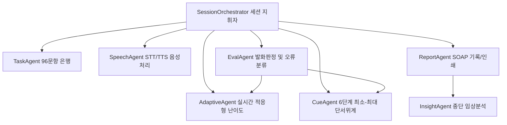

# 🏥 유니원 리햅 (UniRehab Pro v2.0)
> **Agentic AI 성인 언어재활 & 특수교육 지원 솔루션 (Adult Speech-Language Rehabilitation & Special Ed Web App)**

[](https://github.com/doyoon5575/unirehab-speech)
[](LICENSE)
[]()

유니원 리햅(UniRehab Pro)은 뇌졸중(뇌경색·뇌출혈), 외상성 뇌손상(TBI), 신경퇴행성 질환 등으로 인한 성인 실어증(Aphasia) 및 성인전환기 인지-의사소통 장애 대상자의 체계적 회복과 **언어재활사(SLP) 및 특수교사의 현장 수업·임상 치료**를 지원하는 **7대 에이전틱(Agentic AI) 웹 애플리케이션**입니다.

---

## ✨ 핵심 기능 및 7대 에이전틱 아키텍처



1. **치료사·특수교사 원터치 신속 채점 (One-Touch Scoring)**:
   - 태블릿 현장에서 한 손으로 `🟢 자발 정답(100점) / 💡 단서 후 정답(85~25점) / 🔵 부분 산출(70%) / 🔴 오답·무반응(0점)`을 터치 즉시 판정
   - 환자 발음 왜곡·지연 시에도 세션 흐름이 끊기지 않는 현장 친화적 인터페이스
2. **SessionOrchestrator**:
   - 상태머신(State Machine) 기반으로 문항 제시 → 발화 인식/직접 판정 → 단서 위계 승격 → 난이도 적응 → 피드백 루프를 끊김 없이 지휘
3. **TaskAgent & 자체 문항 은행(96문항)**:
   - 4개 핵심 영역: 어휘 인출(이름대기), 문장 완성(구문 산출), 청각적 이해(식별), 일상 대화(화용)
   - 3단계 난이도 위계 (기초 · 중급 · 심화)
4. **CueAgent (최소-최대 단서 위계 체계)**:
   - 임상 표준 Least-to-Most 6단계 단서: `자발(100점) → 의미(85점) → 문맥(75점) → 초성(65점) → 첫음절(55점) → 보기선택(40점) → 따라말하기(25점)`
5. **EvalAgent (다차원 발화 판정 & 오류 분류)**:
   - STT 대체후보 5개 전수 분석 + 한글 자모 단위 음운 유사도
   - 7종 임상 오류 자동 분류 (음소 착어, 의미 착어, 우회 표현, 무반응, 부분 산출 등) + 알기 쉬운 우리말 설명 제공
6. **AdaptiveAgent (실시간 적응형 난이도)**:
   - 수행 연속 성공(3회 자발 정답) 시 실시간 난이도 상향, 오답 지속(2회) 시 자동 하향하여 대상자 좌절 방지
7. **InsightAgent (종단 임상 인사이트)**:
   - 회기 간 추세 분석, 단기치료목표(STG 80%) 3회 연속 달성 여부 판정, 수행 정체 및 훈련 공백 경고
8. **ReportAgent (임상 SOAP 노트)**:
   - 정량 지표 기반 SOAP(주관·객관·평가·계획) 자동 초안 생성 및 실시간 치료사 수정 기능
   - Excel 호환 UTF-8 BOM CSV 내보내기 및 A4 표준 기록지 인쇄

---

## 🎨 디자인 시스템: Clinical Light
- 신뢰감 있는 오프화이트(`#F8FAFC`) 배경과 딥 틸블루(`#0B6E99`), 세이지 민트 헬스케어 팔레트 적용
- 시인성 보장을 위한 **3단계 글자 크기(text-md, text-lg, text-xl)** 및 **고대비 모드(High Contrast)** 지원
- 모바일/태블릿 화면 핀치 줌 확대 허용 (`maximum-scale=5.0`, `user-scalable=yes`)
- 외부 CDN 연결 없이 오프라인에서도 작동하는 독립 인라인 SVG 아이콘 시스템

---

## 🔒 개인정보 및 임상 데이터 보안 정책
- **로컬 격리 저장**: 본 프로그램의 모든 환자/학생 인적사항, 진단명, 훈련 세션 기록은 **100% 사용자 브라우저 로컬 스토리지(LocalStorage)**에 암호화 보관되며 외부 데이터베이스 서버로 전송되지 않습니다.
- **음성 인식 정책**: Web Speech API(브라우저 마이크 인식) 활성화 시 브라우저 플랫폼(Google/Apple)의 표준 음성 변환 정책을 따릅니다. 엄격한 개인정보 보호가 요구되는 병원이나 임상 환경에서는 음성인식을 끄고 **'치료사 원클릭 신속 판정 모드'**를 기본으로 사용하실 수 있습니다.
- **영구 백업 및 복원**: 상단 바의 **[원클릭 백업 (JSON)]** 버튼을 통해 언제든 환자 기록 전체를 암호화된 파일로 내보내고 새 기기에서 즉시 복원할 수 있습니다.

---

## 🚀 빠른 시작 (Local Run)

```bash
# 레포지토리 클론
git clone https://github.com/doyoon5575/unirehab-speech.git
cd unirehab-speech

# 로컬 개발 서버 실행
npm start
# 브라우저에서 http://localhost:3000 접속
```

---

## 📱 PWA & 태블릿 설치
태블릿(iPad Safari, Android Chrome) 브라우저에서 접속 후 **[홈 화면에 추가]**를 누르면 상단 주소창이 없는 독립형 전체화면 재활 전용 앱으로 구동됩니다.
